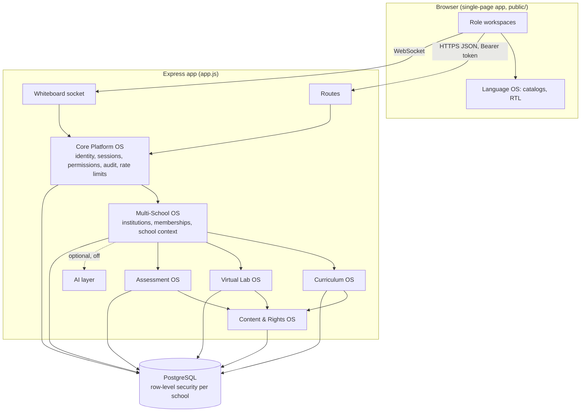

# NovaSchool Global Education OS: foundation architecture

Status: release candidate 1 (RC1). Labels used throughout: **BUILT** (in this
package and tested), **FOUNDATION** (schema and rules exist, no screens or API
yet), **PLANNED** (designed only).

## 1. Shape of the system

NovaSchool stays one Node/Express application with one PostgreSQL database,
split into modules by responsibility rather than into separate services. At
today's scale (one Render free instance, Neon free tier) separate services
would add cost and failure points without benefit. Module boundaries are
enforced by folder, table ownership and the rules below, so a module can be
split out later if load ever requires it.

Dependency rule: arrows point from a module to what it may call. Core and
Multi-School are below everything; Curriculum, Lab and Assessment may read
each other's published records but never write them; Content & Rights is
consulted by all content modules; nothing depends on the AI layer.

## 2. Modules

### 2.1 Core Platform OS (BUILT, hardened in RC1)
- **Identity:** `users` holds one global login per person (email, bcrypt hash, `token_version`).
- **Sessions:** 12-hour JWT (HS256, algorithm pinned). Every request and WebSocket join re-checks `token_version`, current role and account status (`middleware/auth.js#verifySession`). Suspension, password change and admin "force sign-out" increase `token_version`, ending all sessions at once.
- **Permissions:** admin passes all checks; staff permissions come from configurable roles (`staff_roles`, `staff_role_permissions`); a staff member cannot grant a role with more permissions than their own. New in RC1: `messages.oversee`.
- **Audit:** `audit_logs` records who did what to which record. RC1 adds message-oversight views.
- **Abuse controls:** in-memory rate limits (`lib/rateLimit.js`), strict upload validation (`lib/validate.js`), security headers and same-origin CORS (`lib/securityHeaders.js`), configuration checked at start (`lib/config.js`).
- **Observability:** admin System Health page (database response, secret configured, storage used). Error tracking: PLANNED.

### 2.2 Multi-School OS (FOUNDATION, isolation proven at database level)
- Hierarchy: platform → organisation (optional) → institution (the tenant boundary) → campus (optional) → records.
- `institution_memberships` = user + institution + role + status (+ campuses, language). A person may hold several, e.g. teacher at one school and parent at another.
- Every school-owned table carries `institution_id` (49 tables). Shared catalogs (curriculums, boards, levels, lab experiments, question bank, glossary, frameworks) use NULL for platform-provided rows.
- Enforcement (gated migration 0004): `ENABLE` + `FORCE ROW LEVEL SECURITY`, policies `TO nova_app` comparing `institution_id` with the transaction setting `app.institution_id`. The app role is not an owner and has `NOBYPASSRLS`. Migrations run as the owner role, which needs BYPASSRLS (or superuser).
- Context handling: `lib/tenantContext.js#withTenant` opens a transaction and sets the school with `set_config(..., true)`, which ends at COMMIT or ROLLBACK, so pooled connections cannot carry context between requests. Missing context matches no rows; inserts without it fail.
- Not yet done (Phase P3): routes do not yet run inside `withTenant`, memberships are not yet chosen at sign-in, and global unique keys (section code, admission number) are still global. Until then 0004 must stay off and the app behaves as one school.

### 2.3 Curriculum OS (FOUNDATION)
- NovaSchool's own frameworks (`curriculum_frameworks`) → `grade_levels` → `topics` → `learning_outcomes`, with `outcome_prerequisites` (a directed graph; self-links refused).
- Wording lives in translation keys, so one outcome exists once in every language.
- External programmes (Pakistani boards, Cambridge, later Chinese and Korean frameworks) are `curriculum_pathways`. Outcomes map to them by **external code only** (`pathway_mappings.external_code`, max 40 characters), never by copied wording. Mappings start `unverified`; `officially_endorsed` cannot be true without recorded evidence.
- Versioning: frameworks and outcomes carry `version` and `status` (draft → in_review → published → retired). Published versions are never edited in place.

### 2.4 Language OS (FOUNDATION)
- `locales`: English available; Urdu, Arabic, Chinese (Simplified), Korean, French, German, Punjabi (Shahmukhi), Sindhi, Pashto and Balochi planned, with direction (rtl/ltr) and fallback chains (e.g. Punjabi → Urdu → English).
- `translation_keys` + `translations` with status `machine_draft`, `human_draft`, `reviewed`, `approved`; reviewed and approved need a named reviewer. `nova_translate(key, locale)` serves only reviewed text and walks the fallback chain.
- `glossary_terms` for reviewed educational terminology, per platform or per school.
- A student's **learning language** (`students.learning_locale`) is separate from the interface language (`users.locale`) and from the curriculum pathway, so one curriculum can be taught in any supported language.
- Front-end catalogs and right-to-left layout: PLANNED (see the Language OS specification document).

### 2.5 Virtual Lab OS (BUILT engine for 3 experiment types; FOUNDATION for the rest)
- Engines are reusable simulators (`lab_engines`): 3 built and server-scored (series circuit, parallel circuit, pendulum) and 20 planned across physics, chemistry, biology and computer science.
- Experiments are versioned configuration for an engine (`lab_experiments`, `lab_experiment_versions`); attempts and events are recorded and scored on the server (`routes/lab.js`).
- `lab_catalog_plan` + `db/data/lab_catalog_plan.json`: the 100-experiment plan, 25 per subject. 3 entries are available today; 97 are planned. A trigger refuses to mark an experiment available while its engine is planned.
- Adding an engine = a server-side `LAB_TYPE_LOGIC` entry (validate, applyEvent, evaluate, score) + a renderer + tests, then experiments as data.

### 2.6 Assessment OS (BUILT tests/homework; FOUNDATION for banks and mastery)
- Existing: homework, timed tests (time limit now enforced on the server), teacher marking, gradebook.
- New tables: `question_bank_items` (linked to outcomes, cannot be published without a reviewer, AI-drafted flag), `practice_attempts`, `mastery_records` (level 0–4 from observed evidence only).

### 2.7 Content & Rights OS (FOUNDATION)
- `content_sources`: every consulted source with access date, licence, permitted use (`facts_only`, `quote_with_attribution`, `adapt_with_attribution`, `reuse`, `none`), attribution and review status.
- `content_provenance` links any content row to its sources and the relation (informed_by, cites, adapted_from, reused). See `CURRICULUM-AND-IP-POLICY.md`.

### 2.8 Future AI layer (PLANNED, off)
Provider-neutral adapter, off by default per school, monthly budget caps, no student data sent outside without a data agreement, retrieval filtered by school and permission before ranking, every action through observe → analyse → plan → authorise → execute → verify → audit. Nothing in RC1 calls an AI service.

## 3. Data ownership summary

| Scope | Tables | Rule |
| --- | --- | --- |
| Global identity | `users`, `failed_login_attempts`, `permissions` | Not school data; no school can list users of another |
| Platform reference | `locales`, `translation_keys`, `translations`, `subjects`, `lab_engines`, `lab_catalog_plan`, `curriculum_pathways`, `content_sources` | Edited by platform staff; read by all |
| Shared catalogs | curriculums, boards, levels, frameworks, lab experiments, question bank, glossary | NULL = platform row (read-only to schools); otherwise owned by one school |
| School-owned | 49 existing tables + memberships, settings, practice, mastery | Exactly one `institution_id`; row-level security when 0004 is on |

## 4. Event flows

- **Sign-in:** credentials → rate limits → bcrypt check → status check → token with `token_version`. PLANNED: membership choice when a person has more than one.
- **Request:** token → `verifySession` (version, role, status) → permission check → (Phase P3) `withTenant` transaction → query.
- **Suspension:** admin action → status change + `token_version + 1` → next request or socket join refused.
- **Public application:** IP rate limit → field and file validation → stored with a one-time entrance-test token → notifications.
- **Lab attempt:** start (pinned experiment version) → events applied by server logic → completion evaluated and scored on the server.

## 5. Failure handling

- Unsafe production configuration (missing or weak `JWT_SECRET`) stops the server at start.
- Migrations run one file per transaction under an advisory lock; a failure rolls that file back and stops later files.
- Backfill stops (rolls back) if more than one school exists or parent/child schools disagree; questionable rows go to `tenancy_review_queue` for a person.
- Missing school context returns no rows and refuses writes (proven by tests T5, T12).
- Rate limits answer 429 with `Retry-After`.

## 6. Migration strategy

Expand (0001) → backfill and constrain (0002) → module foundations (0003) → row-level security, gated (0004) → later: contract step (per-school unique keys replace global ones; legacy default removed). Each step has a rollback script; the test suite applies all four, rolls them back, and proves the schema returns to its exact starting state.
